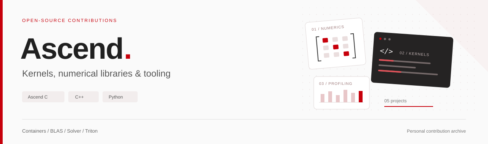

# 昇腾开源贡献集

  
  
  
  
  

本人在昇腾社区完成的五项开发工作，覆盖并行容器、数学库和 Triton 工具支持。

[项目](#项目总览) / [实现](#技术贡献) / [测试结果](#验证与性能) / [上游 PR](#社区记录)

本人负责技术方案、代码实现、测试验证、性能优化、社区提交、验收材料及反馈整改。各项目保留其上游来源与评审记录；具体贡献范围以对应源码和 PR 差异为准。

## 项目总览

| 方向 | 项目 | 核心工作 | 验证平台 |
| :--- | :--- | :--- | :--- |
| 并行容器 | **[StaticMultiset](projects/static-multiset-950/README.md)** | 支持重复键的静态多重集合；插入、查询、计数与检索 | Atlas 950PR |
| 数值计算 | **[LU 分解与求逆](projects/lu-950/README.md)** | FP32 分解、求逆及批量接口；数值稳定性与分规模调度 | Atlas 950PR |
| 数值计算 | **[Complex TRMM](projects/ctrmm-a2a3/README.md)** | 复数三角矩阵乘法；A2 / A3 适配与精度修复 | Ascend 910B2 / A3 |
| 数值计算 | **[Grouped Batched GEMM](projects/sgemm-grouped-batched/README.md)** | FP32 分组批量矩阵乘法；混合规模调度与性能优化 | Ascend 910B2 / A3 |
| 开发工具 | **[MemScope × Triton](projects/memscope-triton/README.md)** | Triton 调用、显存参数及静态读写信息采集 | Ascend 910B3 |

每项详情包含实现入口、测试入口、版本说明和源码校验清单。归档为贡献文件快照，完整构建依赖对应上游工程；详见[贡献与来源说明](CONTRIBUTIONS.md)。

## 技术贡献

### 01 · StaticMultiset

**在 Atlas 950 上实现支持重复键的静态多重集合。**

- 实现容器接口与设备侧访问能力，覆盖插入、条件操作、查找、计数和结果检索。
- 处理容量约束、重复键、多批次插入、无效输入与资源生命周期。
- 构建功能与性能测试，验证大规模数据下的行为一致性及执行效率。

`C++` · `Ascend C / SIMT` · `并行数据结构` · `大规模检索`

### 02 · LU 分解与求逆

**围绕 FP32 数值语义，实现四类分解与求逆接口。**

- 覆盖 `Sgetrf`、`Sgetri`、`SgetriBatched` 和 `SmatinvBatched`。
- 按矩阵阶数与批量规模组织计算路径，处理主元、奇异输入、布局和工作区边界。
- 针对浮点运算顺序与近奇异输入分析误差，结合设备 profiling 优化性能。

`FP32` · `LU Factorization` · `数值稳定性` · `分规模调度`

### 03 · Complex TRMM

**实现 A2 / A3 上的复数三角矩阵乘法，并定位长归约精度问题。**

- 实现 `aclblasCtrmm` 对应计算路径与接口集成，覆盖三角矩阵相关参数组合。
- 比较复数计算组织方式与归约策略，针对实际失败输入修复数值偏差。
- 完成双平台验证，并跟进社区编译、静态检查和精度反馈。

`Complex FP32` · `BLAS` · `Cube / Vector` · `精度诊断`

### 04 · Grouped Batched GEMM

**针对组内不同矩阵规格，优化 FP32 批量矩阵乘法调度。**

- 实现 `aclblasSgemmGroupedBatched` 的 A2 / A3 计算路径及测试集成。
- 结合矩阵形状、批量与归约长度选择执行策略，优化混合负载。
- 验证系数语义、边界输入、异步调用和多流行为，保留逐规格性能证据。

`FP32 GEMM` · `Grouped Batching` · `负载划分` · `多流验证`

### 05 · MemScope × Triton

**为 MemScope 增加 Triton 调用与参数访存信息的采集支持。**

- 接入调用事件、参数地址、存储跨度与时间戳，支持采集开关和原有事件链协作。
- 分析参数的静态可能读写行为，对未知操作保留明确的 `unknown` 语义。
- 验证分支、别名、特化、多次启停与异常恢复，并分别测量 Host 采集开销和设备执行时间。

`Triton` · `Python / C++` · `可观测性` · `静态数据流分析`

## 验证与性能

以下为**指定历史版本的开发者自测摘要**，用于展示工程验证范围。不同项目的用例、硬件和计时方式不同，不作横向排名；这些结果也不等同于最新源码全量通过或官方验收结论。

| 项目 / 版本 | 已记录的验证结果 | 结果边界 |
| :--- | :--- | :--- |
| StaticMultiset · 2026-09-20 CI 整改版 | 15 个功能程序、60 个注册测试、1,706,450 条断言通过；44 项性能达到配套门槛 | 原测试采用 Host wall-clock 计时，不作为独立设备耗时 |
| LU · `acceptance_integrated74` | 712/712 项精度通过；有 GPU 基线的 710/710 项性能通过 | 原测试另有 2 项缺性能基线；不将后续源码修改套用为同版全量实测 |
| CTRMM · `v36` | A2 / A3 各 1,000 项功能精度测试及 200 项性能测试通过 | 性能输入的附加精度检查有历史失败；后续修复版另做定向验证，不能写成所有输入全通过 |
| Grouped GEMM · `v41` | A2 / A3 各 1,973 项功能测试通过，200/200 项性能达到配套门槛 | A2 实测型号为 910B2；不同设备构建与证据分别保存 |
| MemScope Triton · 2026-10-07 | 85 项相关 C++ 测试、44 个基础 NPU 用例及补充采集验证 | 保留上游 CPU 测试失败的基线对照；静态读写与 Host 时间戳均有明确支持边界 |

<strong>如何解读这些结果</strong>

- **正确性**：按对应接口契约、输入集和参考实现判定；测试程序数、参数用例数与断言数分开统计。
- **性能**：保留硬件、源码版本、计时范围和采样规则；Host 时间、设备 kernel 时间与完整模型耗时分别报告。
- **回归**：旧版本全量测试与新版本定向测试分别记录，不合并为一个“全部通过”。
- **社区状态**：设计评审、代码合入、CI 与正式验收分别核对，以对应平台记录为准。

## 社区记录

下面提供可追溯的上游入口。链接用于查看原始贡献和讨论，**本表不预设 PR 当前已合入或验收通过**。

| 项目 | 代码 / 上游入口 | 设计记录 |
| :--- | :--- | :--- |
| StaticMultiset | [ops-collections · PR #50](https://gitcode.com/cann/ops-collections/pull/50) | [设计 PR #1737](https://gitcode.com/cann/cann-ops-competitions/pull/1737) |
| LU | [ops-solver · PR #106](https://gitcode.com/cann/ops-solver/pull/106) | [设计 PR #2269](https://gitcode.com/cann/cann-ops-competitions/pull/2269) |
| CTRMM | [ops-blas · PR #599](https://gitcode.com/cann/ops-blas/pull/599) | [设计 PR #2008](https://gitcode.com/cann/cann-ops-competitions/pull/2008) |
| Grouped GEMM | [ops-blas](https://gitcode.com/cann/ops-blas) | [设计 PR #2067](https://gitcode.com/cann/cann-ops-competitions/pull/2067) |

MemScope Triton 的贡献范围见上文；未在此列出尚未核实的公开 PR 链接。

## 贡献归属与上游致谢

本合集所列项目的技术设计、实现、测试、性能优化、社区提交及验收整改由本人完成。部分任务通过不同报名账号参与社区流程，相关参与者已同意本人整理和发布所开发成果。原始提交身份与评审记录保持可追溯。

这些工作基于相应开源项目开展。上游代码、依赖及参考实现的版权和许可证继续适用；本人贡献范围以具体实现和变更记录为准。感谢昇腾社区维护者及相关开源项目提供的基础设施、技术资料与评审反馈。

---

个人开源贡献合集 · 非华为官方仓库  
<a href="#昇腾开源贡献集">↑ 返回顶部</a>

